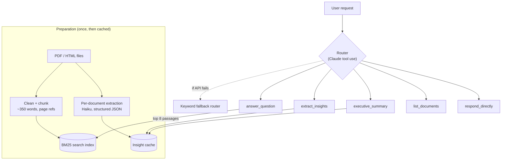

# Document Insight Agent

An AI assistant that reads a collection of business documents and answers consultants' requests: an executive summary, structured tables of risks, opportunities, actions, deadlines and stakeholders, and cited answers to specific questions. An agent layer reads each request and routes it to the right tool.

Built for the AI Engineer take-home using the provided dataset of 11 UK government AI policy documents (~84,000 words). It runs on Anthropic's Claude models.

---

## Contents

1. [Quick start](#quick-start)
2. [What it does](#what-it-does)
3. [Architecture](#architecture)
4. [Agent behaviour](#agent-behaviour)
5. [Example outputs](#example-outputs)
6. [Design decisions and trade-offs](#design-decisions-and-trade-offs)
7. [Assumptions](#assumptions)
8. [Known limitations](#known-limitations)
9. [Proposed improvements](#proposed-improvements)
10. [Testing](#testing)
11. [How this was built](#how-this-was-built)

---

## Quick start

### Prerequisites

- Python 3.10 or newer
- An Anthropic API key from [console.anthropic.com](https://console.anthropic.com). The first full run costs well under £1.

### Install

```bash
git clone <this-repo-url>
cd doc-insight-agent
python -m venv .venv

# Windows
.venv\Scripts\activate
# macOS / Linux
source .venv/bin/activate

pip install -r requirements.txt
```

### Configure

Copy the example settings file and add your key:

```bash
# Windows
copy .env.example .env
# macOS / Linux
cp .env.example .env
```

Then open `.env` and set `ANTHROPIC_API_KEY=sk-ant-...`. The `.env` file is git-ignored, so the key is never committed.

Optional settings in `.env`:

| Variable | Default | Purpose |
|---|---|---|
| `ANTHROPIC_MODEL` | newest Sonnet (auto-detected) | Routing, answers, summaries |
| `ANTHROPIC_FAST_MODEL` | newest Haiku (auto-detected) | Bulk per-document extraction |
| `DATA_DIR` | `data/` | Folder of documents to analyse |

### Run

**Web app (recommended for demos):**

```bash
streamlit run app.py
```

This opens a chat interface in your browser. The sidebar lists the documents, along with any data-quality warnings.

**Command line:**

```bash
python -m docagent.cli docs                         # list documents (no API key needed)
python -m docagent.cli prepare                      # build the insight index once (~2-4 min)
python -m docagent.cli ask "What are the key risks?"
python -m docagent.cli chat                         # interactive session
```

**Regenerate the example outputs:**

```bash
python scripts/generate_examples.py                 # writes examples/EXAMPLES.md
```

> **First run:** the summary and insight tools need every document to be read once, which takes 2–4 minutes on a new API account. After that the results are cached in `.cache/` and responses take seconds. Questions (`answer_question`) work immediately.

---

## What it does

| Required capability | How it is met | Where |
|---|---|---|
| **Document ingestion** | Loads every PDF, HTML, TXT or MD file in `data/`. It detects the real file type from the file's content, strips website clutter (menus, cookie banners, footers), keeps PDF page numbers, and flags suspect files. | `docagent/ingest.py` |
| **Insight extraction** | Pulls risks, opportunities, actions (with owners), deadlines and stakeholders from each document as structured JSON with page references. Results are merged across documents, de-duplicated and ranked. | `docagent/insights.py`, `Toolbox.extract_insights` |
| **Question answering** | Finds the most relevant passages with keyword search, then answers using only those passages, citing each claim (`[S1]` → document and page). It says so when the answer isn't in the documents. | `docagent/retrieval.py`, `Toolbox.answer_question` |
| **Executive summary** | Structured for senior readers (bottom line, key messages, risks, opportunities, next steps). The **300-word limit is enforced in code**: one retry, then a hard cap on a sentence boundary. | `Toolbox.executive_summary` |
| **Agent behaviour** | Claude routes each request to one or more of five tools via function calling, with a keyword-based fallback router if the model is unavailable. | `docagent/agent.py` |

---

## Architecture



There are two processing paths, chosen because the tasks differ:

1. **Search path (questions).** Questions need specific passages, so documents are split into ~350-word chunks and indexed. Each question retrieves the top 8 chunks and Claude answers from those alone. This is retrieval-augmented generation (RAG).
2. **Map-reduce path (summaries and insights).** "What are the risks across everything?" can't be answered from 8 chunks. Instead, each document is read once by the cheaper Haiku model ("map"), which returns structured JSON. The tools then consolidate those small records with Sonnet ("reduce"). The map results are cached, so the expensive reading happens once rather than on every request.

**Code layout**

```
app.py                  Streamlit web interface
docagent/
  config.py             Settings from environment / .env
  ingest.py             Load, clean and chunk documents
  retrieval.py          BM25 keyword search
  llm.py                Anthropic API wrapper (text, structured output, tool routing)
  insights.py           Per-document extraction + disk cache
  tools.py              The five tools the agent can call
  agent.py              Router, executor, fallback, conversation history
  cli.py                Command-line interface
scripts/generate_examples.py
tests/test_agent.py     Offline tests (no API key needed)
data/                   The provided dataset
examples/EXAMPLES.md    Generated example outputs
```

---

## Agent behaviour

Every request goes through one routing step:

1. **Route.** Claude receives the request, the last three exchanges of conversation, and a menu of five tools with JSON schemas. The system prompt requires it to call at least one tool and fill in its arguments. If it replies in plain text instead, that reply is treated as a direct response. Newer Claude models don't accept a *forced* tool choice, which I found during testing, so the instruction lives in the prompt. Each tool has a required `reason` argument, so every routing decision is explained and shown in the UI.
2. **Execute.** Python runs the chosen tool(s). Several tools can be chosen for a multi-part request ("summarise and list the risks"), capped at three.
3. **Fall back.** If the routing call fails (network error, rate limit), a deterministic keyword router picks a tool so the user still gets a result. The response is labelled `keyword-fallback`.

| Example request | Routed to | Arguments the router fills in |
|---|---|---|
| "Summarise the documents" | `executive_summary` | `focus` (e.g. "for a defence client") |
| "Identify the key risks" | `extract_insights` | `categories: ["risk"]`, optional `topic` |
| "List actions and owners" | `extract_insights` | `categories: ["action"]` |
| "What is the AISI's mission?" | `answer_question` | `search_query` rewritten with keywords and synonyms |
| "Which documents are loaded?" | `list_documents` | none |
| "What's the weather?" | `respond_directly` | a short reply explaining what the tool can do |
| "...and which of those relate to procurement?" | resolved from conversation history | |

The router does useful work beyond picking a tool. It rewrites vague questions into keyword-rich search queries (which also compensates for keyword search not knowing synonyms) and resolves follow-ups using the conversation history.

**Why a single routing step rather than an autonomous loop?** Every request in this use case maps to one or two well-defined tools. A single routing call is cheaper, faster, predictable and easy to audit, which matters for consulting work where outputs go to senior clients. A loop (the model calls a tool, reads the result, decides what to do next) would be the next step for open-ended research tasks. See [improvements](#proposed-improvements).

---

## Example outputs

See **[examples/EXAMPLES.md](examples/EXAMPLES.md)** for full outputs of 12 requests: the executive summary, risk, action, deadline and stakeholder extraction, factual questions, a follow-up, a multi-intent request, an out-of-scope request and a data-quality check. Each one shows which tool it was routed to and why.

---

## Design decisions and trade-offs

| Decision | Why | Trade-off accepted |
|---|---|---|
| **BM25 keyword search** instead of vector embeddings | No extra service or key (Anthropic has no embeddings API). It runs offline and instantly, it's easy to debug, and policy documents use consistent terminology. | Misses synonyms; partly offset by the router rewriting queries. |
| **Map-reduce with a cache** for insights and summaries | Cross-document questions need every document, not 8 chunks. Caching means ~115k input tokens are processed once rather than per request. | A 2–4 minute first run, and the cache must be rebuilt if documents change (handled automatically by hashing content). |
| **Two models** (Haiku for bulk extraction, Sonnet for reasoning) | Bulk reading is the expensive part and Haiku costs about a third as much; user-facing quality comes from Sonnet. | Haiku may miss subtle items in long documents. |
| **Structured outputs** (`output_config` JSON schema), with tool-call fallback | The API guarantees valid JSON matching a schema, so there is no fragile parsing of free text. If the feature is unavailable, the code falls back to offering the schema as a tool. | Schema changes need a cache version bump (`PROMPT_VERSION`). |
| **Word limit enforced in code** | "Max 300 words" is a hard requirement, and models are unreliable at counting. | Rarely, a hard cap may cut the final sentence. |
| **Sections of ≤12,000 words** for extraction | Keeps each request under the per-minute token limits of a new API account. | More calls for the largest report. |
| **Auto-detect newest models** | Model names change; this avoids the code going stale. Can be pinned in `.env`. | Output may differ slightly between model versions. |
| **Streamlit** front end | A working chat UI in ~150 lines, suitable for a demo. | Not a production web stack (no auth, single-process). |

---

## Assumptions

- **Users are consultants** who need fast, defensible answers, so every answer cites its source and says when the documents don't cover something.
- **Senior audience** means plain English, a bottom line first and no jargon.
- **The documents are public** (GOV.UK publications), so sending them to a cloud AI API is acceptable. For confidential client material this would need review (see limitations).
- **"Deadlines"** includes any dated milestone or time-bound commitment, not only formal deadlines.
- **Owners are recorded only when the text names them.** The extraction prompt forbids guessing, so some actions show "-" as the owner. This is deliberate.
- **The dataset is used as provided**, including its quirks, which are flagged rather than silently "fixed".

### Data-quality findings in the provided dataset

The tool detects and reports these automatically (sidebar, `list_documents`, CLI `docs`):

- **`AI_Playbook_for_UK_Government.pdf` is not a PDF.** It is a saved HTML web page. A parser that trusted the extension would crash. The file is detected as HTML and parsed correctly.
- **That file is also only the GOV.UK landing page** for the playbook (~290 words). The 118-page playbook itself is not in the dataset, so the agent cannot answer detailed questions about the playbook's content, and it says so.
- **Most of the web pages are thin.** Once menus and footers are removed, seven of the eight HTML files contain under 2,000 words of real content, and five contain under 400. These are index or landing pages that mostly link elsewhere, so they are flagged and users know not to rely on them for depth.
- The CMA's **Initial Report (129 pages) dominates** the corpus at ~59% of all words. Insight ranking caps each document's contribution so one long report doesn't crowd out the rest.

---

## Issues found in live testing

The offline tests use a fake model, so the first runs against the real API surfaced three issues. Each is now fixed and covered by a test:

| Issue | Symptom | Fix |
|---|---|---|
| Newer Claude models reject a *forced* tool choice | Routing failed with an API error. The keyword fallback router took over, so the user still got a correct answer. | Routing instructs the model to call a tool via the prompt; structured data uses the API's structured-outputs feature. |
| Replies cut off by the token limit | The executive summary stopped after 15 words. Newer models can spend part of the token allowance on internal reasoning. | The code checks `stop_reason` and retries with a higher limit, rather than silently returning half an answer. |
| Model-invented page numbers | One web page was cited as "p.3", but web pages have no pages. | Page numbers are removed in code for non-PDF sources, so the prompt doesn't have to be trusted. |

The lesson I drew from this: don't trust the model with anything the code can check itself.

## Known limitations

- **Keyword search misses paraphrases.** A question about "hazards" may not find text that only says "risks". The router's query rewriting helps but does not fully solve it.
- **PDF tables and charts are read as plain text**, so tabular data may lose its structure. Scanned (image-only) PDFs are not supported (no OCR).
- **Extraction quality depends on the model.** Items can occasionally be mis-categorised, and the per-category "top 10" is a judgement call by the model.
- **Document metadata is not captured.** The tool knows a document's title but not its author or publisher. For example, it doesn't "know" the Foundation Models reports are by the CMA unless the retrieved passage says so.
- **No evaluation set.** Accuracy was checked by spot-reading outputs against the source documents, not measured systematically.
- **Single user, local only.** There is no login and no shared deployment. Conversation history is lost on restart.
- **Data is sent to Anthropic's API.** That's fine for public documents, but client-confidential documents would need a data-handling review or a private deployment (e.g. via Azure, AWS Bedrock or Google Vertex).
- **Cost and latency are not tracked per request** in the UI.

---

## Proposed improvements

In priority order for a real deployment:

1. **Hybrid search:** add vector embeddings alongside BM25 to catch synonyms, plus a re-ranking step.
2. **An evaluation harness:** 30–50 question/answer pairs with known sources, scored automatically for correctness and citation accuracy, run on every change.
3. **Upload in the UI:** drag-and-drop new documents, with the index and cache updating incrementally.
4. **Export:** download insights as Excel and summaries as Word for client deliverables.
5. **Agent loop for research tasks:** let the agent chain tools ("find the risks, then check each against the security guidance") with a step limit and a visible trace.
6. **Security and governance:** authentication, audit logging, PII redaction before sending to the API, and a private model endpoint for confidential material.
7. **Better PDF parsing:** table extraction and OCR for scanned documents.
8. **Cost and latency telemetry** per request.

---

## Testing

```bash
python -m pytest -q
```

There are 28 offline tests, and no API key is needed: the model is replaced by a fake. They cover:

- detection of the mislabelled PDF, clutter removal and page-numbered chunks
- search relevance
- the keyword fallback router
- model routing → correct tool, multi-intent requests and fallback on API failure
- conversation history
- caching (the second run makes no extraction calls)
- the API wrapper: structured outputs, fallback to tool calls, plain-text replies during routing, and retrying truncated replies
- web pages never being given page numbers
- enforcement of the 300-word limit

---

## How this was built

As the brief allows, I built this with AI coding assistance (Claude). My focus was on the parts that need judgement:

- choosing the architecture and trade-offs
- framing the outputs for a senior consulting audience
- spotting and handling the dataset's quality issues
- deciding what to enforce in code rather than trust to the model (the word limit, citations, "don't invent owners")
